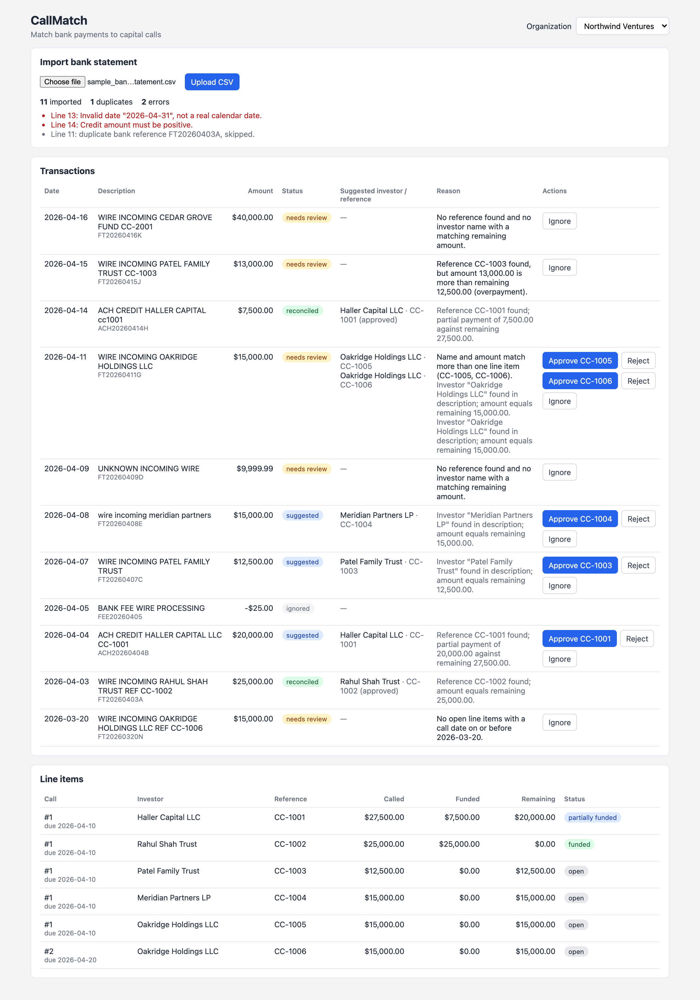
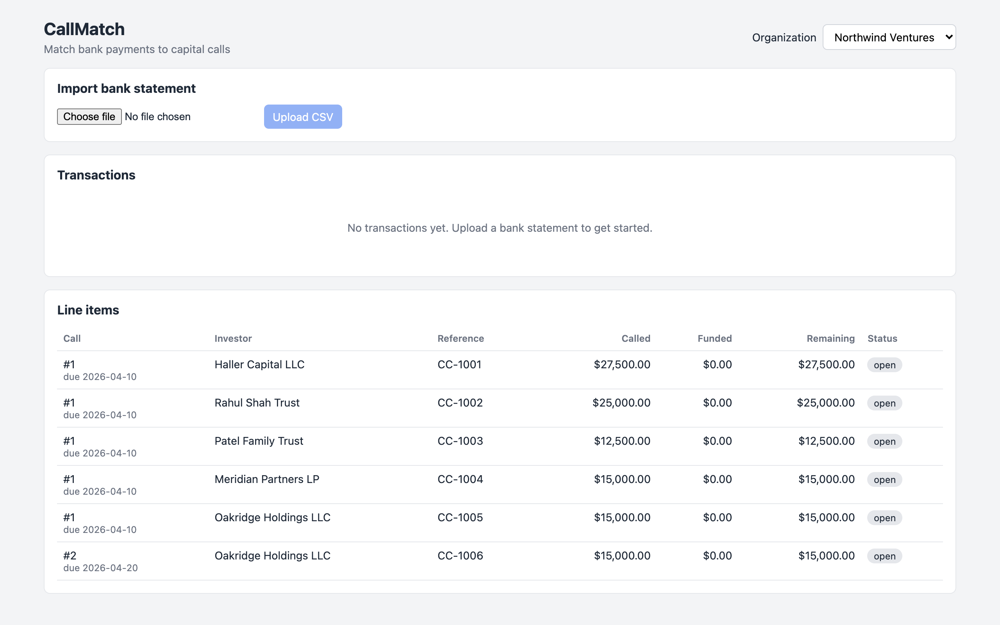
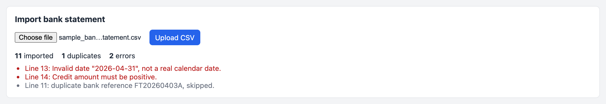
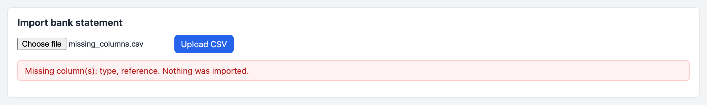
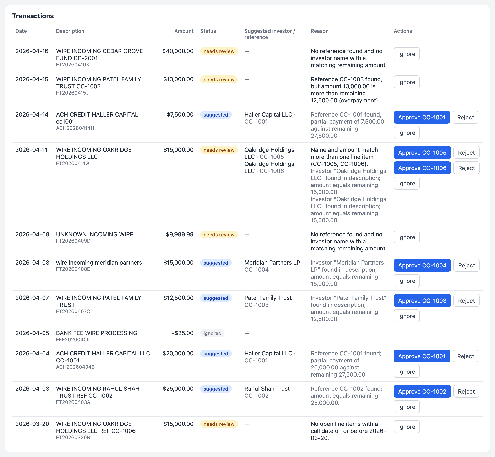
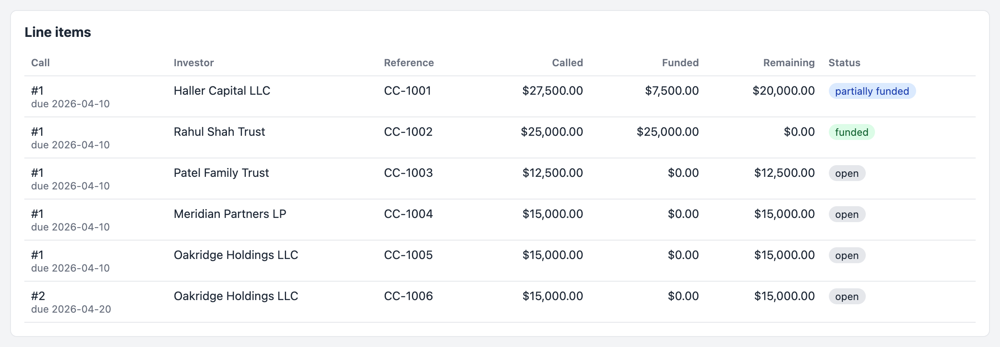
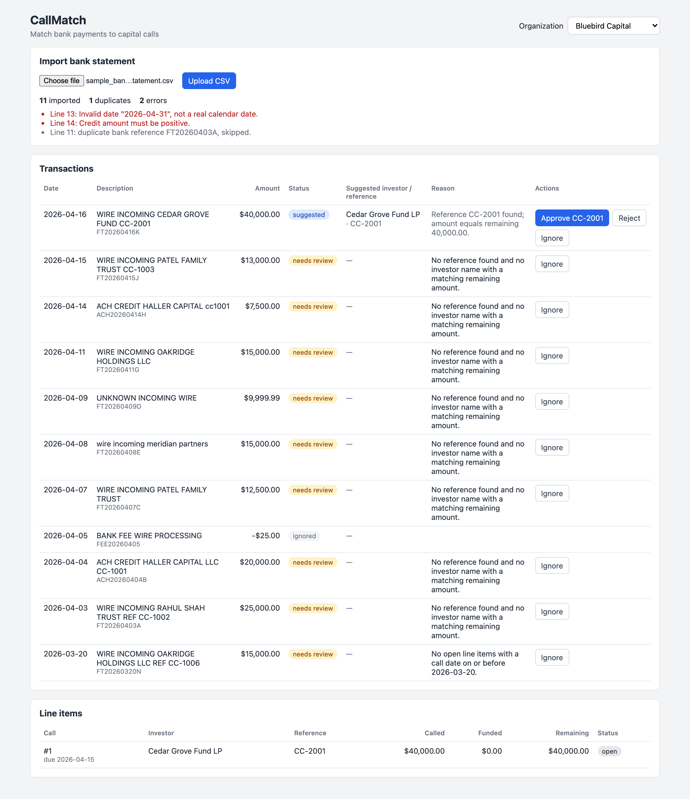

# CallMatch

[](https://callmatch.onrender.com)
[](https://callmatch.onrender.com)


CallMatch helps a GP reconcile a fund's bank statement against its capital calls.

When a fund calls capital, every LP wires its share to the fund's bank account. The bank descriptions are messy: some LPs include the reference (`CC-1003`), some write it differently (`cc1003`), and some only put their name. CallMatch imports the bank statement, suggests which capital call line item each payment belongs to, explains why, and lets the GP approve, reject or ignore each suggestion. Approving a match updates how much that LP has paid.

## Live demo

**The project is deployed and you can try it right now, no setup needed.**

| | URL |
|---|---|
| **App** | **https://callmatch.onrender.com** |
| **API** | https://callmatch-api.onrender.com/api/organizations/ |

To try it in under a minute:

1. Open the app and pick **Northwind Ventures** in the top right.
2. Upload a bank statement CSV (see [CSV format](#csv-format)).
3. Look at the suggestions and reasons, then approve one. The **Line items** panel updates straight away.
4. Switch to **Bluebird Capital** to see that each organization's data is kept separate.

> It runs on Render's free plan. The API sleeps when nobody has used it for a while, so the very first load can take up to a minute. After that it's quick.



Built with **Django + Django REST Framework + PostgreSQL** on the backend and **React (Vite)** on the frontend.

---

## Contents

- [Live demo](#live-demo)
- [Getting started](#getting-started)
- [Using the app](#using-the-app)
- [CSV format](#csv-format)
- [How matching works](#how-matching-works)
- [Running the tests](#running-the-tests)
- [API](#api)
- [Project structure](#project-structure)
- [Deployment](#deployment)

---

## Getting started

You need **Python 3.12+**, **Node 20.19+** and a running **PostgreSQL**.

### 1. Backend

```bash
git clone https://github.com/amartya1523/Digital_Alpha_platform_assignment.git
cd Digital_Alpha_platform_assignment

python3 -m venv .venv
source .venv/bin/activate
pip install -r requirements.txt

cp .env.example .env          # put your Postgres user/password in here
createdb recon

python manage.py migrate
python manage.py seed_demo    # creates the demo orgs, capital calls and line items
python manage.py runserver    # API on http://localhost:8000
```

`seed_demo` is safe to run as many times as you like. It never creates duplicates.

### 2. Frontend

In a second terminal:

```bash
cd frontend
npm install
npm run dev                   # app on http://localhost:5173
```

Open **http://localhost:5173**. The Vite dev server forwards every `/api` request to Django, so you don't need any CORS setup.

### Environment variables

| Variable | Default | What it's for |
|---|---|---|
| `DB_NAME` | `recon` | Postgres database name |
| `DB_USER` / `DB_PASSWORD` | empty | Postgres login |
| `DB_HOST` / `DB_PORT` | `localhost` / `5432` | Postgres location |
| `DJANGO_SECRET_KEY` | dev key | Set a real one outside local dev |
| `DJANGO_DEBUG` | `1` | `0` turns debug off |
| `AIRTABLE_TOKEN`, `AIRTABLE_BASE_ID`, `AIRTABLE_TABLE` | empty | Optional, see [Airtable sync](#airtable-sync-optional) |

---

## Using the app

### 1. Pick an organization

Use the **Organization** dropdown in the top right. The demo has two: **Northwind Ventures** and **Bluebird Capital**. Everything on the page (transactions, line items, uploads) belongs to the selected organization only.

Before any upload you'll see the line items from the seed data, all `open` with nothing funded:



### 2. Upload a bank statement

Click **Choose file**, pick a CSV and press **Upload CSV**. Once it's done you get a summary: how many rows were imported, how many were duplicates, and every row that was skipped, with its line number in the file (the header is line 1).



Bad rows don't stop the import. They're skipped and listed, and the good rows still go in. If you upload the same file again, every row shows up as a duplicate and nothing new is saved.

If the file is missing one of the required columns, the whole file is rejected and nothing is saved:



### 3. Review the suggestions

Every incoming payment (credit) is matched as soon as it's imported. The table shows the status, the suggested investor and reference, and the reason for the suggestion.



| Status | Meaning |
|---|---|
| `suggested` | One clear match was found. Check the reason and approve it. |
| `needs_review` | No match, more than one possible match, or an overpayment. The reason says which. |
| `reconciled` | A match was approved. This is final. |
| `ignored` | Money going out (debits), or something you chose to ignore. |

### 4. Approve, reject or ignore

- **Approve CC-xxxx** links the payment to that line item. The line item's funded amount goes up, the transaction becomes `reconciled` and any other suggestions for it are rejected. When a transaction has more than one candidate, there's an approve button for each one, so you can pick the right one.
- **Reject** removes that suggestion. If it was the last one, the transaction moves to `needs_review`.
- **Ignore** sets the transaction aside and rejects its suggestions.

Buttons are disabled while a request is running, and the page refreshes after every action. If an action is no longer possible (for example, the payment no longer fits because another payment was approved first), you'll see a message instead.

### 5. Check the line items

The **Line items** panel shows what each LP was asked for, what has been funded so far and what's left. Here a full payment from Rahul Shah Trust and a partial payment from Haller Capital have been approved:



A line item is `open` (nothing paid), `partially_funded` or `funded`. It can be paid in several parts, but it can never be funded above the amount called.

### 6. Switch organization

Switching the dropdown loads a completely separate set of data. Here's the same sample file uploaded to **Bluebird Capital**. Only Cedar Grove's payment matches, because the other references belong to Northwind:



---

## CSV format

The file needs these columns (the order doesn't matter, and extra columns are ignored):

```csv
date,description,amount,type,reference
2026-04-03,WIRE INCOMING RAHUL SHAH TRUST REF CC-1002,"25,000.00",credit,FT20260403A
2026-04-05,BANK FEE WIRE PROCESSING,-25.00,debit,FEE20260405
```

| Column | Rules |
|---|---|
| `date` | `YYYY-MM-DD`, and it must be a real date (`2026-04-31` is rejected) |
| `description` | Required |
| `amount` | Thousands separators are fine (`"25,000.00"`), up to 2 decimals, never zero. Credits must be positive and debits negative. |
| `type` | `credit` or `debit`, in any case |
| `reference` | The bank's own ID for the transaction. Required. Used to spot duplicates. |

Spaces around any value are trimmed before it's checked. Amounts are stored as exact decimals, never floats.

---

## How matching works

For each new credit:

1. **Eligible line items** are the ones in the same organization that still have money remaining and whose capital call was sent on or before the payment date.
2. **Reference check.** Is an eligible line item's reference in the description or bank reference? Case, dashes and spaces are ignored, so `cc1003` matches `CC-1003`.
   - One found and the amount fits → `suggested` (full or partial payment)
   - One found but the amount is too large → `needs_review` (overpayment, no match)
   - More than one found → all are proposed and the transaction is `needs_review`
3. **Name and amount check** (only if no reference was found). The investor's name has to appear as whole words in the description, and the amount has to equal the remaining amount exactly. A trailing `LLC`, `LP`, `LTD` or `INC` in the name is ignored, so "Meridian Partners LP" matches "wire incoming meridian partners".
   - One found → `suggested`
   - More than one → all proposed, `needs_review`
   - None → `needs_review` with no match

Every match, and every `needs_review` transaction, stores a short reason, and that reason is what you see in the table.

Approving re-checks the amount against what's remaining *right now*. Approve runs in a single database transaction with row locks, so the same approval sent twice at the same moment only funds the line item once. The second request gets a `409`.

### Airtable sync (optional)

If `AIRTABLE_TOKEN` and `AIRTABLE_BASE_ID` are set in `.env`, every new `needs_review` transaction is also created as a record in an Airtable table (default name `Needs Review`). The table needs these columns: `Bank Reference`, `Organization`, `Date`, `Description`, `Amount`, `Reason`. If Airtable is down or the token is wrong, the import still works and the transaction is marked `sync_failed`.

---

## Running the tests

```bash
python manage.py test
```

There are 44 tests covering:

- CSV validation (missing columns, amount parsing, bad dates, sign/type mismatches)
- duplicates
- reference matching and name + amount matching
- overpayments
- approve, reject and ignore
- double approvals, including a test that fires two approvals at the same moment from two threads
- isolation between organizations
- the Airtable sync, using a fake client

The Postgres user needs permission to create databases, because Django creates a temporary test database.

---

## API

Every endpoint except the organization list needs an `X-Organization` header, for example `X-Organization: northwind`.

- A missing header returns `400`.
- An unknown organization returns `404`.
- Asking for another organization's record also returns `404`.

| Method | Path | Description |
|---|---|---|
| GET | `/api/organizations/` | Organizations for the switcher |
| GET | `/api/line-items/` | Line items with called, funded, remaining and status |
| GET | `/api/transactions/` | Transactions with matches and reasons, newest first |
| POST | `/api/transactions/import/` | Upload a CSV (`multipart/form-data`, field `file`) |
| POST | `/api/transactions/{id}/ignore/` | Ignore a transaction |
| POST | `/api/matches/{id}/approve/` | Approve a proposed match |
| POST | `/api/matches/{id}/reject/` | Reject a proposed match |

For example:

```bash
curl -H "X-Organization: northwind" -F "file=@sample_bank_statement.csv" \
     http://localhost:8000/api/transactions/import/
```

Request and response examples are in [ASSESSMENT_NOTES.md](ASSESSMENT_NOTES.md#api).

---

## Project structure

```
config/                     Django settings and root URLs
recon/
  models.py                 Organization, InvestorEntity, CapitalCall, LineItem, BankTransaction, Match
  importer.py               reads and validates the CSV, finds duplicates, saves rows
  matching.py               normalisation and the matching rules
  actions.py                approve / reject / ignore
  airtable.py               optional Airtable sync
  views.py, urls.py         thin API layer
  serializers.py
  management/commands/seed_demo.py
  tests/
frontend/
  src/App.jsx               page layout, org switcher, data loading
  src/UploadPanel.jsx       CSV upload and import summary
  src/TransactionTable.jsx  transactions and their actions
  src/LineItemPanel.jsx     line items
screenshots/                images used in this README
```

The views stay small: they read the organization header, call a function in `importer.py` or `actions.py`, and return the result. All the business rules live in those service modules.

More detail on the data model, assumptions and trade-offs is in [ASSESSMENT_NOTES.md](ASSESSMENT_NOTES.md).

---

## Deployment

The live demo is deployed on [Render](https://render.com) from [`render.yaml`](render.yaml) (a Render Blueprint). That one file creates everything:

| Resource | What it is |
|---|---|
| `callmatch-db` | PostgreSQL database |
| `callmatch-api` | The Django API, run with gunicorn. On every start it runs `migrate` and `seed_demo`, which are both safe to repeat. |
| `callmatch` | The React build, served as a static site |

The frontend finds the API through `VITE_API_URL`. The API only accepts browser requests from the frontend's address (`CORS_ALLOWED_ORIGINS`) and only answers on its own hostname. Debug is off and the secret key is generated by Render.

To deploy your own copy: in Render go to **New → Blueprint**, point it at this repository, fill in those two URLs when it asks, and deploy.
